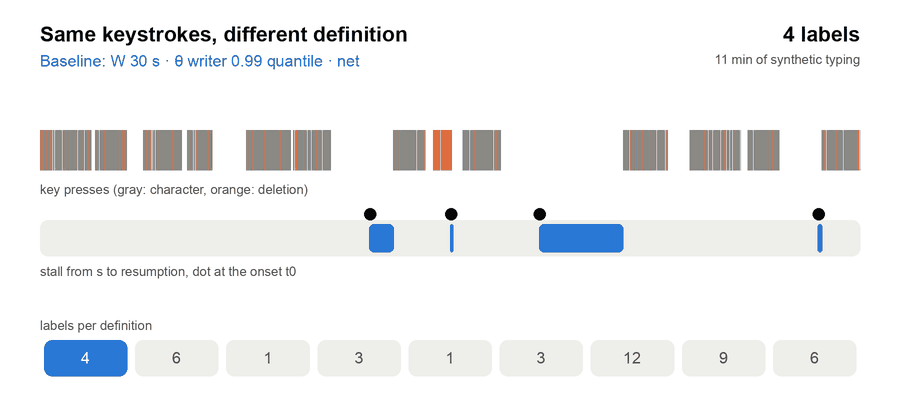
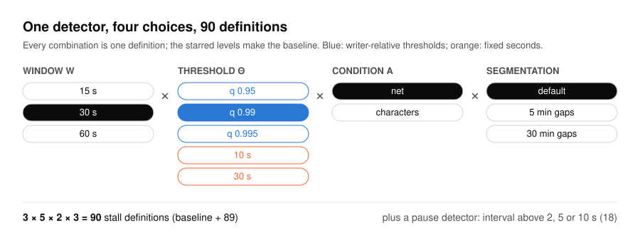
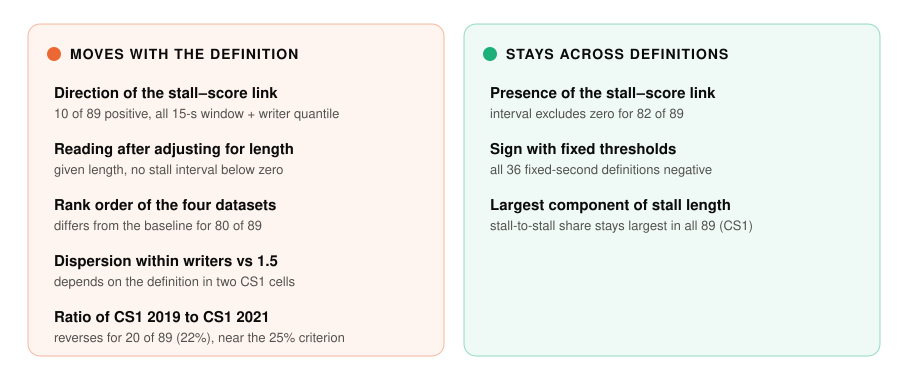
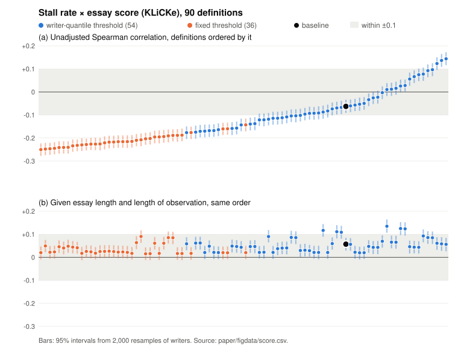

<p align="center">
  
</p>

<p align="center">
  <b>打鍵の休止・停滞のラベルから引いた結論のうち、定義を動かすと動くのはどれか。</b><br>
  停滞 90 通り・休止 36 通りの定義で調べた multiverse の診断の、コード・条件・集計の結果。
</p>

<p align="center">
  <a href="https://doi.org/10.5281/zenodo.24047695"></a>
  <a href="LICENSE-MIT"></a>
  <a href="LICENSE-docs"></a>
  
</p>

<p align="center"><a href="README.md">English</a> | <b>日本語</b></p>

---

原稿 *What moves with the pause definition and the adjustment: a multiverse diagnostic of pause and stall labels in
keystroke logs*（三浦尊統・2026）に付随するリポジトリです。

## 1 枚で見る問題

<p align="center">
  
</p>

休止や停滞は打鍵の中にあるのではなく、打鍵を読む規則の中にあります。同じ 11 分の打鍵でも、窓・閾値・何を止まりと
数えるか・記録をどこで切るかで、ラベルは 1 個から 12 個まで変わります。休止の率を作文の得点と結びつけたり、学年の
間で比べたりする研究は、それぞれこの規則を 1 つに固定しています。その結論のうち、規則を替えても残るのはどれかを
調べました。

<sub>アニメーションは、この研究の検出器（`core.detect`）を合成の打鍵列に当てたものです。データは使っておらず、
論文の数はここから来ていません。</sub>

## 振ったもの

<p align="center">
  
</p>

研究用に公開された 4 つのデータに当てました。入門プログラミングの授業の 2 つの年版（CS1 2019・2021）、総合の得点
つきの作文のコーパス KLiCKe、言語モデルの提案つきの作文のコーパス CoAuthor です。どの結論にも、書き手を 2,000 回
引き直した 95% 区間を付けています。

## 分かったこと

<p align="center">
  
</p>

<p align="center">
  
</p>

停滞の率と得点の相関は大半の定義で負で、正になるのは 15 秒の窓と書き手の分位の閾値の組だけでした（a）。作文の長さで
調整すると、負の定義は無くなります（b）。報告のときの持ち帰り: 各選択の値と、定義と調整をまたいだ結論の幅を、
区間つきで示すこと。

## リポジトリの中身

| 場所 | 中身 |
|---|---|
| `experiments/20261107-stall-shape-multiverse/scripts/` | 検出器・90 通りの定義・論文のすべての計算 |
| `experiments/20261107-stall-shape-multiverse/results/` | 定義ごとの集計の結果（JSON） |
| `experiments/20261107-stall-shape-multiverse/conditions*.md` | 各計算の前にコミットした条件（日本語・[参照を伏せた写し](experiments/20261107-stall-shape-multiverse/REDACTED.md)） |
| `experiments/20261107-stall-shape-multiverse/conditions-summary-en.md` | **条件の英語の要約**（補足 S1 の順） |
| `experiments/20261107-stall-shape-multiverse/notes.md` | 各計算の記録と読み（日本語・参照を伏せた写し） |
| `experiments/20261103-stall-candidates-c1c2c6/candidates.py` | 元のモジュールのうち、スクリプトが使う 2 つの定義をそのまま写したもの |
| `experiments/2026110{1,4}-*/scripts/`・`experiments/20261031-*/scripts/` | データの変換（姉妹の研究のアーカイブと同じバイト） |
| `paper/` | 原稿と補足の LaTeX。`paper/figdata/` は図のデータ（定義ごと） |
| `tools/verify.py` | 生のデータ・書き手ごとの表・識別子・秘密・手元のパスが無いことの検査 |
| `tools/readme_media.py` | このページの図をすべて描く |

<details>
<summary><b>ここに無いものと、その理由</b></summary>

- **データそのもの。** KLiCKe と CoAuthor は公開されています。CS1 は著者に申請して受け取るもので、データの著者との
  約束で集計値だけを公開しています。
- **書き手ごとの値・識別子・中間のファイル。** repo の外に置いています。
- **観測区間を持つ作業用のファイル。** 姉妹の研究の推定器から作ります。姉妹の研究のアーカイブ
  [10.5281/zenodo.24026278](https://doi.org/10.5281/zenodo.24026278) で作ってください。姉妹の研究の原稿はプレプリント
  [10.5281/zenodo.24026330](https://doi.org/10.5281/zenodo.24026330) で読めます。
- **著者の内部の作業記録。** 日本語の条件と記録では、それへの参照を `[internal reference removed]` に置き換えました。
  `REDACTED.md` に、元のファイルの SHA-256 と置き換えた数を載せています。

</details>

## 再現する

```bash
# 1. 姉妹の研究のアーカイブで作業用のファイルを作る（そちらの README を参照）
# 2. 主の計算を回す（先に自己検査と変異の検査を回し、通らなければ止まる）
export DATA_DIR=/path/outside/this/repo PY=/path/to/python3   # NumPy・SciPy・statsmodels の入った Python 3
bash experiments/20261107-stall-shape-multiverse/run.sh
# 3. アーカイブとこのページの図を検査する
python3 -I tools/verify.py
python3 -I tools/readme_media.py --check
```

追加の計算（補足 S1 の順序 2〜11）は、各条件に書いたスクリプトを同じ seed（`SEED`）で回します。版は
`experiments/20261107-stall-shape-multiverse/env.md` にあります。

どの計算も、走らせる前に著者のバージョン管理に条件をコミットしてから回しました。第三者の登録ではなく、順序は
リポジトリが示すもので、独立の時刻の証明ではありません（`source-commit.txt` は組み立てに使った commit）。

## ライセンスと引用

コード: MIT か Apache-2.0（`LICENSE-MIT`・`LICENSE-APACHE`）。文章・結果・図: CC BY 4.0（`LICENSE-docs`）。
アーカイブを引用するときは `CITATION.cff` か [10.5281/zenodo.24047695](https://doi.org/10.5281/zenodo.24047695) を使ってください。
