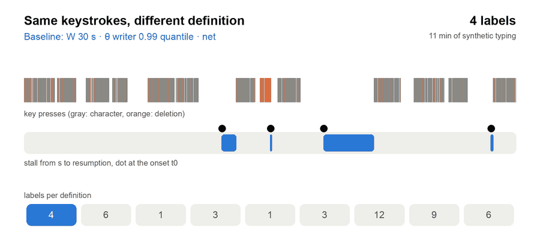
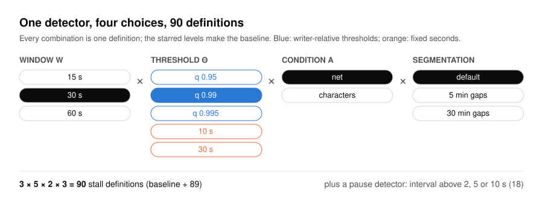
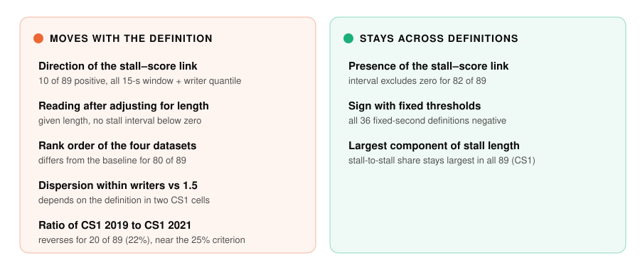
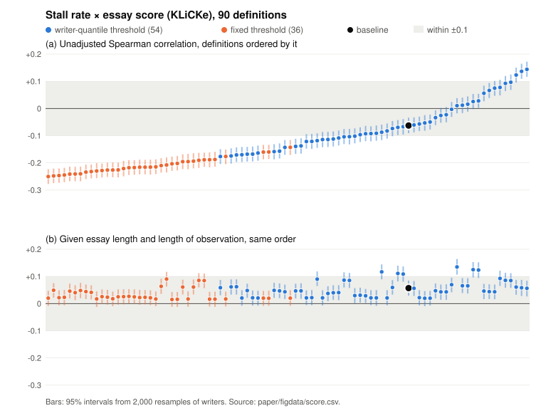

<p align="center">
  
</p>

<p align="center">
  <b>Which conclusions drawn from keystroke pause and stall labels move when the definition moves?</b><br>
  Code, conditions and aggregate results of a multiverse diagnostic across 90 stall and 36 pause definitions.
</p>

<p align="center">
  <a href="https://doi.org/10.5281/zenodo.24047695"></a>
  <a href="LICENSE-MIT"></a>
  <a href="LICENSE-docs"></a>
  
</p>

<p align="center"><b>English</b> | <a href="README.ja.md">日本語</a></p>

---

This repository accompanies *What moves with the pause definition and the adjustment: a multiverse diagnostic of pause
and stall labels in keystroke logs* (Mikoto Miura, 2026).

## The problem in one picture

<p align="center">
  
</p>

A pause or stall is not in the keystrokes; it is in the rule that reads them. The same eleven minutes of typing give
1 to 12 labels depending on the window, the threshold, what counts as a stop and where the log is cut. Studies that
relate pause rates to essay scores or compare them between cohorts each fix one such rule. We asked which of their
conclusions would survive a change of rule.

<sub>The animation runs the study's own detector (`core.detect`) on a synthetic stream; no data and no number of the
paper come from it.</sub>

## What we varied

<p align="center">
  
</p>

The detector was applied to four datasets released for research: two editions of an introductory programming course
(CS1 2019 and 2021), the KLiCKe essay corpus with holistic scores, and the CoAuthor corpus of writing with model
suggestions. Every conclusion carries a 95% interval from 2,000 resamples of writers.

## What we found

<p align="center">
  
</p>

<p align="center">
  
</p>

The stall–score correlation is negative for most definitions and positive only where a 15-s window meets a
writer-quantile threshold (a); given essay length, no definition stays negative (b). The take-away for a report:
give the value of each choice, and the range of the conclusion across definitions and adjustments, with intervals.

## Inside the repository

| Path | What it holds |
|---|---|
| `experiments/20261107-stall-shape-multiverse/scripts/` | The detector, the 90 definitions and every computation of the paper |
| `experiments/20261107-stall-shape-multiverse/results/` | Aggregate results per definition (JSON) |
| `experiments/20261107-stall-shape-multiverse/conditions*.md` | Conditions committed before each computation, in Japanese ([redacted copies](experiments/20261107-stall-shape-multiverse/REDACTED.md)) |
| `experiments/20261107-stall-shape-multiverse/conditions-summary-en.md` | **English summary of the conditions**, in the order of Supplement S1 |
| `experiments/20261107-stall-shape-multiverse/notes.md` | The record of each computation and its reading (Japanese, redacted) |
| `experiments/20261103-stall-candidates-c1c2c6/candidates.py` | The two definitions of the original module the scripts use, copied verbatim |
| `experiments/2026110{1,4}-*/scripts/`, `experiments/20261031-*/scripts/` | Dataset conversion, byte-identical to the companion archive |
| `paper/` | LaTeX sources of the manuscript and supplement; `paper/figdata/` holds the figure data (per definition) |
| `tools/verify.py` | Checks that no raw data, per-writer table, identifier, secret or local path is in the archive |
| `tools/readme_media.py` | Draws every figure on this page |

<details>
<summary><b>What is not here, and why</b></summary>

- **The datasets.** KLiCKe and CoAuthor are public. The CS1 files are released by their authors on request, and by
  agreement with them only aggregate values are published.
- **Per-writer values, identifiers and intermediate files.** They stay outside the repository.
- **The working files with observation intervals.** They come from the estimator of the companion study; build them
  with the companion archive, [10.5281/zenodo.24026278](https://doi.org/10.5281/zenodo.24026278). The companion
  manuscript is available as a preprint, [10.5281/zenodo.24026330](https://doi.org/10.5281/zenodo.24026330).
- **The author's internal working notes.** In the Japanese conditions and notes, references to them read
  `[internal reference removed]`; `REDACTED.md` lists the SHA-256 of each original and the number of references removed.

</details>

## Reproduce

```bash
# 1. build the working files with the companion archive (see its README)
# 2. run the primary computation (self-tests and mutation checks first; it stops if a check fails)
export DATA_DIR=/path/outside/this/repo PY=/path/to/python3   # Python 3 with NumPy, SciPy, statsmodels
bash experiments/20261107-stall-shape-multiverse/run.sh
# 3. check the archive and the figures of this page
python3 -I tools/verify.py
python3 -I tools/readme_media.py --check
```

The added computations (Supplement S1, orders 2–11) are run by the scripts named in each condition, with the same
seed (`SEED`). Versions are in `experiments/20261107-stall-shape-multiverse/env.md`.

Every computation ran under a condition committed to the author's version control before it ran. These are not
third-party registrations; their order is shown by the repository, not by an independent time stamp
(`source-commit.txt` gives the commit this archive was assembled from).

## License and citation

Code: MIT or Apache-2.0 (`LICENSE-MIT`, `LICENSE-APACHE`). Text, results and figures: CC BY 4.0 (`LICENSE-docs`).
To cite the archive, see `CITATION.cff` or use [10.5281/zenodo.24047695](https://doi.org/10.5281/zenodo.24047695).
